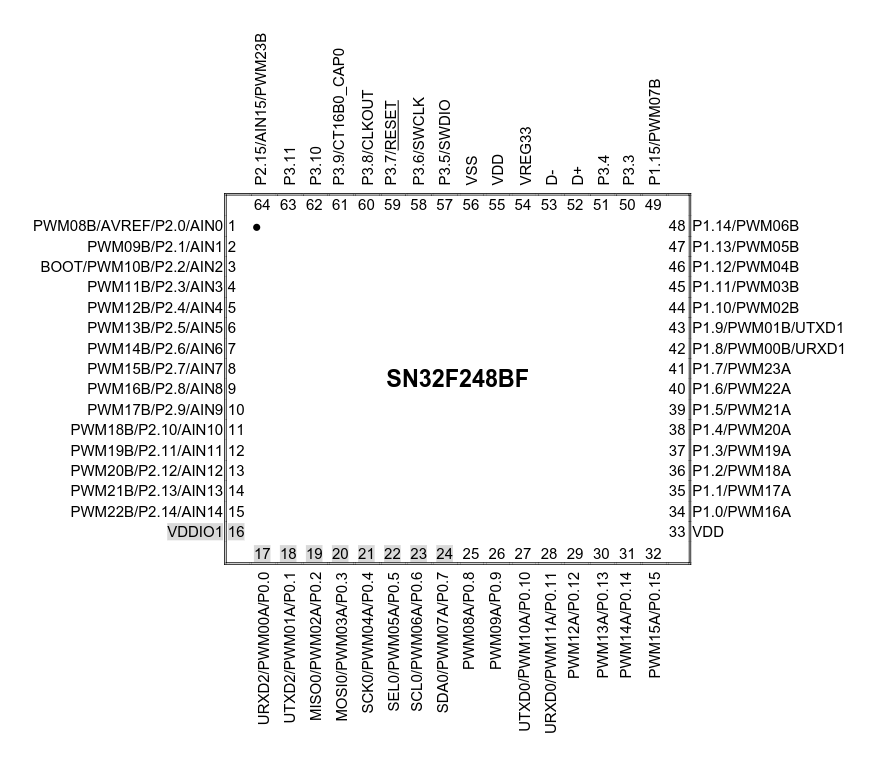

# Hardware Specification & Technical Architecture: Xingmeng M87

Complete Hardware Reverse-Engineering, Pinout, Matrix Schematic & Wireless UART Protocol Specification.

* **Target Device**: **Xingmeng M87** Tri-Mode Wireless Mechanical Keyboard (International market name: **Attack Shark M87**).
* **Form Factor**: ANSI TKL 87-key + 1 Dedicated RGB Mode Indicator + 3 Auxiliary Underglow Strips.
* **Primary Keyboard MCU**: **SONiX SN32F248BF** (Rebranded as **HFD2201KBA**) — 32-bit ARM Cortex-M0 @ 48MHz, 64KB Flash, 8KB SRAM, LQFP-64 package.
* **Wireless Coprocessor**: **WCH CH582F** — 32-bit RISC-V, integrated Bluetooth 5.3 BLE & 2.4GHz RF transceivers.
* **QMK/ChibiOS Support**: Fully operational in all 3 modes (Wired USB, 3-Profile Bluetooth, 2.4GHz RF Dongle, RGB Matrix, and VIA Key Remapping).

---

## 1. Hardware Architecture & MCU Pinout (LQFP-64)

* **Official MCU Product Page**: [SONiX SN32F248B Product Page](https://www.sonix.com.tw/page/vg/SN32F248B?lang=1)

<p align="center">
  
</p>

### 1.1. Port Mapping: SONiX to ChibiOS HAL
The SONiX SN32F240 architecture organizes I/O into four 16-bit ports, corresponding directly to Ports A, B, C, and D in ChibiOS HAL:
* **Port 0** (`P0.0 .. P0.15`) <-> **Port A** (`A0 .. A15`)
* **Port 1** (`P1.0 .. P1.15`) <-> **Port B** (`B0 .. B15`)
* **Port 2** (`P2.0 .. P2.15`) <-> **Port C** (`C0 .. C15`)
* **Port 3** (`P3.0 .. P3.15`) <-> **Port D** (`D0 .. D15`)

---

### 1.2. Complete 64-Pin Allocation Table (SN32F248BF / HFD2201KBA)

| Pin # | Chip Pad | ChibiOS Symbol | Function on PCB | Electrical Characteristics & Hardware Notes |
| :---: | :---: | :---: | :--- | :--- |
| **1** | **P2.0** | `C0` | **Key Col 12** / PWM Col 12 | Matrix Column 12 Drive & LED Column 12 Cathode |
| **2** | **P2.1** | `C1` | **Key Col 11** / PWM Col 11 | Matrix Column 11 Drive & LED Column 11 Cathode |
| **3** | **P2.2** | `C2` | **Key Col 10** / PWM Col 10 | Matrix Column 10 Drive & **Hardware BOOT Pin** (Pull Low on plug-in to enter ISP Bootloader) |
| **4** | **P2.3** | `C3` | **Key Col 9** / PWM Col 9 | Matrix Column 9 Drive & LED Column 9 Cathode |
| **5** | **P2.4** | `C4` | **Key Col 8** / PWM Col 8 | Matrix Column 8 Drive & LED Column 8 Cathode |
| **6** | **P2.5** | `C5` | **Key Col 7** / PWM Col 7 | Matrix Column 7 Drive & LED Column 7 Cathode |
| **7** | **P2.6** | `C6` | **Key Col 6** / PWM Col 6 | Matrix Column 6 Drive & LED Column 6 Cathode |
| **8** | **P2.7** | `C7` | **Key Col 5** / PWM Col 5 | Matrix Column 5 Drive & LED Column 5 Cathode |
| **9** | **P2.8** | `C8` | **Key Col 4** / PWM Col 4 | Matrix Column 4 Drive & LED Column 4 Cathode |
| **10** | **P2.9** | `C9` | **Key Col 3** / PWM Col 3 | Matrix Column 3 Drive & LED Column 3 Cathode |
| **11** | **P2.10** | `C10` | **Key Col 2** / PWM Col 2 | Matrix Column 2 Drive & LED Column 2 Cathode |
| **12** | **P2.11** | `C11` | **Key Col 1** / PWM Col 1 | Matrix Column 1 Drive & LED Column 1 Cathode |
| **13** | **P2.12** | `C12` | **Key Col 0** / PWM Col 0 | Matrix Column 0 Drive & LED Column 0 Cathode |
| **14** | **P2.13** | `C13` | NC / Reserved | Unused |
| **15** | **P2.14** | `C14` | NC / Reserved | Unused |
| **16** | **VDDIO1** | — | **I/O Power (3.3V)** | Power rail for Port C GPIO |
| **17** | **P0.0** | `A0` | **UART2 RX (`URXD2`)** | Serial input received from CH582F (TX) |
| **18** | **P0.1** | `A1` | **UART2 TX (`UTXD2`)** | Serial output transmitted to CH582F (RX) |
| **19** | **P0.2** | `A2` | **VBUS Sense** | USB 5V presence detection (`1` = Charging / USB connected) |
| **20** | **P0.3** | `A3` | **CapsLock LED** | Dedicated single-color indicator (Active-High) |
| **21** | **P0.4** | `A4` | **WinLock LED** | Dedicated single-color indicator (Active-High) |
| **22** | **P0.5** | `A5` | NC / Reserved | Unused |
| **23** | **P0.6** | `A6` | **Slide Switch: 2.4GHz** | Physical 3-position switch (`0` = 2.4GHz Mode, Active-Low) |
| **24** | **P0.7** | `A7` | **Slide Switch: Bluetooth** | Physical 3-position switch (`0` = Bluetooth Mode, Active-Low) |
| **25** | **P0.8** | `A8` | **LED Row 0 — Red** | Red channel for Esc / F1..F12 |
| **26** | **P0.9** | `A9` | **LED Row 0 — Blue** | Blue channel for Esc / F1..F12 |
| **27** | **P0.10** | `A10` | **LED Row 0 — Green** | Green channel for Esc / F1..F12 |
| **28** | **P0.11** | `A11` | **LED Row 1 — Red** | Red channel for Number Row (`~ 1..0 =`) |
| **29** | **P0.12** | `A12` | **LED Row 1 — Blue** | Blue channel for Number Row |
| **30** | **P0.13** | `A13` | **LED Row 1 — Green** | Green channel for Number Row |
| **31** | **P0.14** | `A14` | **LED Row 2 — Red** | Red channel for Tab / QWERTY Row |
| **32** | **P0.15** | `A15` | **LED Row 2 — Blue** | Blue channel for Tab / QWERTY Row |
| **33** | **VDD** | — | **Main Core Supply (3.3V)** | MCU core power |
| **34** | **P1.0** | `B0` | **LED Row 2 — Green** | Green channel for Tab / QWERTY Row |
| **35** | **P1.1** | `B1` | **LED Row 3 — Red** | Red channel for CapsLock / ASDF Row |
| **36** | **P1.2** | `B2` | **LED Row 3 — Blue** | Blue channel for CapsLock / ASDF Row |
| **37** | **P1.3** | `B3` | **LED Row 3 — Green** | Green channel for CapsLock / ASDF Row |
| **38** | **P1.4** | `B4` | **LED Row 4 — Red** | Red channel for LShift / ZXCV Row |
| **39** | **P1.5** | `B5` | NC / Reserved | Unused |
| **40** | **P1.6** | `B6` | **Left Side Strip PWM (Ch 22)** | Underglow strip (8 LEDs) PWM driver |
| **41** | **P1.7** | `B7` | **LED Row 4 — Blue** | Blue channel for LShift / ZXCV Row |
| **42** | **P1.8** | `B8` | **LED Row 4 — Green** | Green channel for LShift / ZXCV Row |
| **43** | **P1.9** | `B9` | **Right Side Strip PWM (Ch 1)** | Underglow strip (8 LEDs) PWM driver |
| **44** | **P1.10** | `B10` | **LED Row 5 — Green** | Green channel for Spacebar / Bottom Row |
| **45** | **P1.11** | `B11` | **Logo Strip PWM (Ch 3)** | Front badge lightbar (6 LEDs) PWM driver |
| **46** | **P1.12** | `B12` | **Key Col 16** / PWM Col 16 | Matrix Column 16 Drive & LED Column 16 Cathode |
| **47** | **P1.13** | `B13` | **Key Col 15** / PWM Col 15 | Matrix Column 15 Drive & LED Column 15 Cathode |
| **48** | **P1.14** | `B14` | **LED Row 5 — Blue** | Blue channel for Spacebar / Bottom Row |
| **49** | **P1.15** | `B15` | **Key Col 14** / PWM Col 14 | Matrix Column 14 Drive (contains Mode LED) |
| **50** | **P3.3** | `D3` | **LED Row 5 — Red** | Red channel for Spacebar / Bottom Row |
| **51** | **P3.4** | `D4` | Test Pad / Sub-Mode | Factory test pad (pulled high) |
| **52** | **USB D+** | — | **USB Full-Speed Data+** | USB 2.0 Full-Speed (12 Mbps) |
| **53** | **USB D-** | — | **USB Full-Speed Data-** | USB 2.0 Full-Speed (12 Mbps) |
| **54** | **VREG33** | — | **Internal Regulator Output** | Decoupling cap connection (1uF/0.1uF) |
| **55** | **VDD** | — | **Main Core Supply (3.3V)** | MCU core power |
| **56** | **VSS / GND** | — | **Ground (GND)** | Common system ground |
| **57** | **P3.5** | `D5` | **SWDIO / Debug** | SWD Hardware Programming (not a Mac/Win switch) |
| **58** | **P3.6** | `D6` | **Key Row 5** / SWCLK | Matrix Row 5 Input (LCtrl, LWin, Space, Arrows...) |
| **59** | **P3.7** | `D7` | **Key Row 4** | Matrix Row 4 Input (LShift, Z, X, C, V...) |
| **60** | **P3.8** | `D8` | **Key Row 3** | Matrix Row 3 Input (CapsLock, A, S, D, F...) |
| **61** | **P3.9** | `D9` | **Key Row 2** | Matrix Row 2 Input (Tab, Q, W, E, R...) |
| **62** | **P3.10** | `D10` | **Key Row 1** | Matrix Row 1 Input (~`, 1, 2, 3, 4...) |
| **63** | **P3.11** | `D11` | **Key Row 0** | Matrix Row 0 Input (Esc, F1..F12, PrtSc...) |
| **64** | **P2.15** | `C15` | **Key Col 13** / PWM Col 13 | Matrix Column 13 Drive & LED Column 13 Cathode |

---

## 2. Key Switch Matrix Specification

* **Scanning Method**: Active-High column driving (`BSET` registers on GPIO2 and GPIO1), followed by sensing on 6 rows via `GPIO3->DATA`.
* **Diode Direction**: `COL2ROW`.
* **Row Pull-downs**: Configured internally via `GPIO3->CFG`.

### 2.1. 17 Matrix Columns (Outputs)
Scan order from Column 0 to Column 16:
`C12, C11, C10, C9, C8, C7, C6, C5, C4, C3, C2, C1, C0, C15, B15, B13, B12`

### 2.2. 6 Matrix Rows (Inputs)
Input sense pins on Port D (`GPIO3`):
* **Row 0**: `P3.11` (`D11`, Pin 63)
* **Row 1**: `P3.10` (`D10`, Pin 62)
* **Row 2**: `P3.9`  (`D9`,  Pin 61)
* **Row 3**: `P3.8`  (`D8`,  Pin 60)
* **Row 4**: `P3.7`  (`D7`,  Pin 59)
* **Row 5**: `P3.6`  (`D6`,  Pin 58)

### 2.3. Full Matrix Coordinate Map [Row, Col] (ANSI TKL 87 Keys)

| Row | Col 0 | Col 1 | Col 2 | Col 3 | Col 4 | Col 5 | Col 6 | Col 7 | Col 8 | Col 9 | Col 10 | Col 11 | Col 12 | Col 13 | Col 14 | Col 15 | Col 16 |
| :---: | :---: | :---: | :---: | :---: | :---: | :---: | :---: | :---: | :---: | :---: | :---: | :---: | :---: | :---: | :---: | :---: | :---: |
| **Row 0 (`D11`)** | Esc | F1 | F2 | F3 | F4 | F5 | F6 | F7 | F8 | F9 | F10 | F11 | F12 | — | PrtSc | ScrLk | Pause |
| **Row 1 (`D10`)** | ~ ` | 1 | 2 | 3 | 4 | 5 | 6 | 7 | 8 | 9 | 0 | - | = | Backspace | Insert | Home | PgUp |
| **Row 2 (`D9`)** | Tab | Q | W | E | R | T | Y | U | I | O | P | [ | ] | \ | Delete | End | PgDn |
| **Row 3 (`D8`)** | CapsLock | A | S | D | F | G | H | J | K | L | ; | ' | — | Enter | — | — | — |
| **Row 4 (`D7`)** | LShift | — | Z | X | C | V | B | N | M | , | . | / | — | RShift | *(Mode LED)* | Up | — |
| **Row 5 (`D6`)** | LCtrl | LWin | LAlt | — | — | — | Space | — | — | — | RAlt | Fn | App | RCtrl | Left | Down | Right |

---

## 3. RGB LED Matrix & Underglow Strip Architecture

### 3.1. Multiplexing Architecture
* **Common Anode**: 18 row color lines (6 physical rows x 3 colors: Red, Blue, Green) are driven high sequentially.
* **PWM Cathode Sinks**: Managed by 16-bit hardware timer `SN_CT16B1`. Includes 17 column channels for the 87 switch LEDs, plus 3 separate peripheral channels for the side and logo strips.

### 3.2. 18-Channel Row Color Pins (Anodes)
```c
#define SN32F2XX_RGB_MATRIX_ROW_PINS { \
    A8,  A9,  A10, /* Row 0 (Esc / F1..F12) - Red, Blue, Green */ \
    A11, A12, A13, /* Row 1 (Numbers 1..0 =) - Red, Blue, Green */ \
    A14, A15, B0,  /* Row 2 (Tab / QWERTY)   - Red, Blue, Green */ \
    B1,  B2,  B3,  /* Row 3 (CapsLock / ASDF) - Red, Blue, Green */ \
    B4,  B7,  B8,  /* Row 4 (LShift / ZXCV)  - Red, Blue, Green */ \
    D3,  B14, B10  /* Row 5 (Space / Bottom) - Red, Blue, Green */ \
}
```

### 3.3. Underglow Strips & Strip Mirroring (`XINGMENG_M87_STRIP_MIRROR`)
The three auxiliary strips share anode power lines with the main rows, but sink current through dedicated PWM channels:
* **Pin 40 (`B6` / `P1.6`)**: Left Side Strip (8 LEDs, PWM Channel 22). Mirrored from Column 0 color data (`C12`), with hardware Red/Green channel swap.
* **Pin 43 (`B9` / `P1.9`)**: Right Side Strip (8 LEDs, PWM Channel 1). Mirrored from Column 16 color data (`B12`), with hardware Red/Green channel swap.
* **Pin 45 (`B11` / `P1.11`)**: Front Logo Lightbar (6 LEDs, PWM Channel 3). Mirrored from Column 8 color data (`C4`).

---

## 4. Status Indicators & Dedicated RGB Mode LED

### 4.1. Single-Color Indicators
1. **CapsLock Indicator**: Pin 20 (`P0.3` / `A3`), Active-High.
2. **WinLock Indicator**: Pin 21 (`P0.4` / `A4`), Active-High.
3. **VBUS Power Sense**: Pin 19 (`P0.2` / `A2`), reads `1` when USB 5V power is connected.

### 4.2. Dedicated RGB Mode Indicator (Index 87)
* **Physical Location**: Matrix coordinate `[Row 4, Col 14]`.
* **QMK Configuration**: Tagged with `LED_FLAG_INDICATOR` so global RGB animations do not overwrite connection state feedback.
* **Status Profiles**:
  * **Bluetooth Profile 1 (`Fn + 1`)**: Solid Blue (`R: 0, G: 0, B: 255`).
  * **Bluetooth Profile 2 (`Fn + 2`)**: Solid Cyan (`R: 0, G: 255, B: 255`).
  * **Bluetooth Profile 3 (`Fn + 3`)**: Solid Magenta (`R: 255, G: 0, B: 255`).
* **Behavior**:
  * **Searching / Reconnecting**: Slow blink (512ms period) for up to 5 seconds, then turns off to conserve power.
  * **Pairing Mode** (holding `Fn + 1/2/3` for 3 seconds): Fast blink (256ms period) for up to 60 seconds.
  * **Connected**: Displays solid profile color for 2 seconds, then turns completely off to prevent distraction.
  * **2.4GHz / Wired USB Mode**: Remains completely off.

---

## 5. Serial Communication Protocol: SN32F248B <-> WCH CH582F

Communication between the main keyboard controller and the WCH CH582F wireless coprocessor is conducted over hardware serial interface **UART2**:

```text
+------------------------------------+              +------------------------------------+
|       SONiX SN32F248B (MCU)        |              |       WCH CH582F (Wireless)        |
|                                    |              |                                    |
| Pin 18 (P0.1 / UTXD2) ------------>|------------->| RXD                                |
| Pin 17 (P0.0 / URXD2) <------------|<-------------| TXD                                |
+------------------------------------+              +------------------------------------+
```

### 5.1. Hardware Initialization
1. **Peripheral Function Pin Assignment (PFPA)**:
   ```c
   *(volatile uint32_t *)0x40042000 = 0x009FFFBA;
   ```
   Reroutes internal UART2 peripherals to physical pads Pin 17 (`P0.0`) and Pin 18 (`P0.1`).
2. **SWD Pin Protection**:
   ```c
   SN_SYS0->SWDCTRL |= 1;
   ```
   Frees debug pins to prevent conflict with normal GPIO.
3. **UART2 Clock & Baud Rate Setup**:
   ```c
   SN_SYS1->AHBCLKEN |= (1 << 18);
   SN_GPIO0->BSET = 3u;
   SN_UART2->LC = 0x83;  // DLAB = 1
   SN_UART2->FD = 0;
   SN_UART2->DLM = 0;
   SN_UART2->DLL = 26;   // 48 MHz / (16 * 26) = 115,200 bps (8-N-1)
   SN_UART2->LC = 0x03;  // 8-N-1
   SN_UART2->FIFOCTRL = 0x07; // Enable & reset 16-byte FIFO
   SN_UART2->CTRL = 0xC1;     // Enable UART, RX, and TX
   ```

### 5.2. Packet Structure & Checksum
All packets end with an 8-bit checksum:
```c
// Checksum is the 8-bit sum of all preceding bytes in the packet:
checksum = (Byte[0] + Byte[1] + ... + Byte[N-2]) & 0xFF;
```

### 5.3. TX Commands (SN32F248B -> CH582F)

| Opcode | Length | Description | Payload Structure |
| :---: | :---: | :--- | :--- |
| **`0xA1`** | 10 B | 6KRO Standard Report | `[0xA1, Modifier, 0x00, Key1..Key6, Checksum]` |
| **`0xA2`** | 16 B | NKRO Bitmap Report | `[0xA2, Bitmap[0]..Bitmap[13], Checksum]` |
| **`0xA3`** | 4 B | Consumer Media Key | `[0xA3, Usage_LSB, Usage_MSB, Checksum]` |
| **`0xA5`** | 3 B | OS Mode Select | `[0xA5, 0x10, 0xB5]` (Windows PC Mode) / `[0xA5, 0x00, 0xA5]` (Mac Mode) |
| **`0xAD`** | 6 B | Set USB VID/PID | `[0xAD, VID_L, VID_H, PID_L, PID_H, Checksum]` (`0x0C45 / 0x8006`) |
| **`0xA9`** | Dynamic | Set BLE Device Name | `[0xA9, Length, Name_Bytes..., Checksum]` (`"M87 Keyboard"`) |
| **`0xA6`** | 3 B | Select BT Profile 1 | `[0xA6, 0x31 ('1'), 0xD7]` |
| **`0xA6`** | 3 B | Select BT Profile 2 | `[0xA6, 0x32 ('2'), 0xD8]` |
| **`0xA6`** | 3 B | Select BT Profile 3 | `[0xA6, 0x33 ('3'), 0xD9]` |
| **`0xA6`** | 3 B | Select 2.4GHz Mode | `[0xA6, 0x30 ('0'), 0xD6]` |
| **`0xA6`** | 3 B | Switch to Wired Mode | `[0xA6, 0x11, 0xB7]` |
| **`0xA6`** | 3 B | Initiate BLE Pairing | `[0xA6, 0x51, 0xF7]` |
| **`0xA6`** | 3 B | Poll Battery Level | `[0xA6, 0x53 ('S'), 0xF9]` |
| **`0x61`** | 3 B | Handshake ACK | `[0x61, 0x0D, 0x0A]` (`"a\r\n"`) |

### 5.4. RX Reports (CH582F -> SN32F248B)

| Header | Param | Description | Meaning |
| :---: | :---: | :--- | :--- |
| **`0x5B` (`'['`)** | `0x32` / `0x43` | Link Connected | Host device successfully connected |
| **`0x5B` (`'['`)** | `0x31` | Link Pairing | Module in pairing discovery state |
| **`0x5B` (`'['`)** | `0x33` / `0x42` | Link Disconnected | Host connection lost |
| **`0x5A` (`'Z'`)** | `0x00 .. 0x07` | Host LED State | Bit 0 = NumLock, Bit 1 = CapsLock, Bit 2 = ScrollLock |
| **`0x5C` (`'\'`)** | `0x00 .. 0x64` | Battery Level | Current charge percentage (0% to 100%) |
| **`0x61` (`'a'`)** | `0x0D, 0x0A` | Module ACK | Confirms successful command execution |

---

## 6. Power Management & Slide Switch Configuration

The 3-position physical slide switch connects directly to Port 0 input pins with internal pull-ups:
* **Pin 24 (`P0.7` / `A7`)**: Bluetooth position.
* **Pin 23 (`P0.6` / `A6`)**: 2.4GHz RF position.

| Switch Position | Pin 24 (`A7`) | Pin 23 (`A6`) | Operating State |
| :--- | :---: | :---: | :--- |
| **Left (BT)** | **Low (`0`)** | High (`1`) | **Bluetooth Mode** (CH582F BLE active) |
| **Center (OFF/Wired)** | High (`1`) | High (`1`) | **Wired USB Mode** (battery isolated when unplugged) |
| **Right (2.4G)** | High (`1`) | **Low (`0`)** | **2.4GHz RF Mode** (CH582F RF active) |

---

## 7. Firmware Flashing & Recovery

* **Security Level**: `CS0` (unlocked code security, permits direct overwriting).
* **Write Offset**: `0x0000` (begins at start of 64KB flash space).
* **Flashing Tool**: `sonixflasher` via Sonix USB ISP bootloader (`VID: 0x0C45, PID: 0x7040`).

---

## 8. Linux Kernel Driver Compatibility

When paired over Bluetooth, the CH582F coprocessor reports Bluetooth Vendor ID `05AC` and Product ID `024F` (the device signature of an Apple Magic Keyboard).

On Ubuntu/Debian distributions, the `hid_apple` kernel driver automatically assumes Apple mode (`fnmode = 3` or `1`), remapping the `F1..F12` row to multimedia controls. To force standard PC function keys globally across Linux:

```bash
# Apply immediately:
echo 2 | sudo tee /sys/module/hid_apple/parameters/fnmode

# Persist across reboots:
echo "options hid_apple fnmode=2" | sudo tee /etc/modprobe.d/hid_apple.conf
sudo update-initramfs -u
```
*(Automated via `scripts/fix_fkeys.sh`).*
